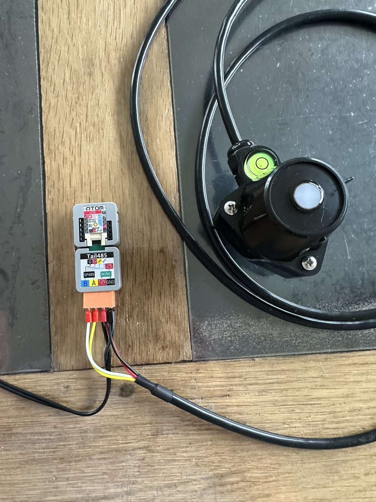
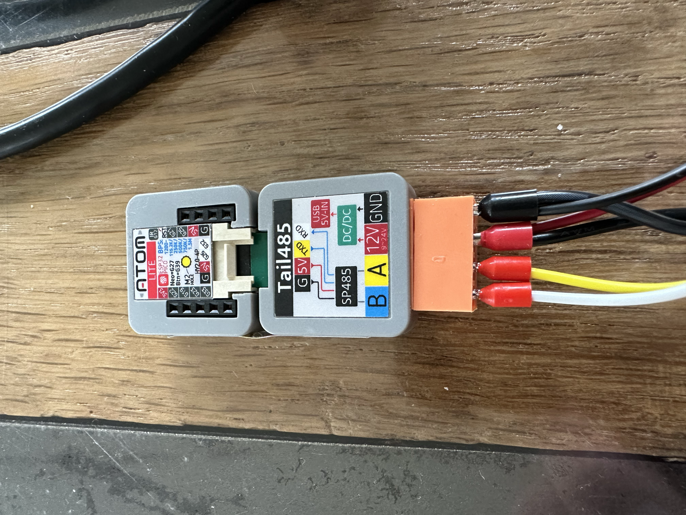
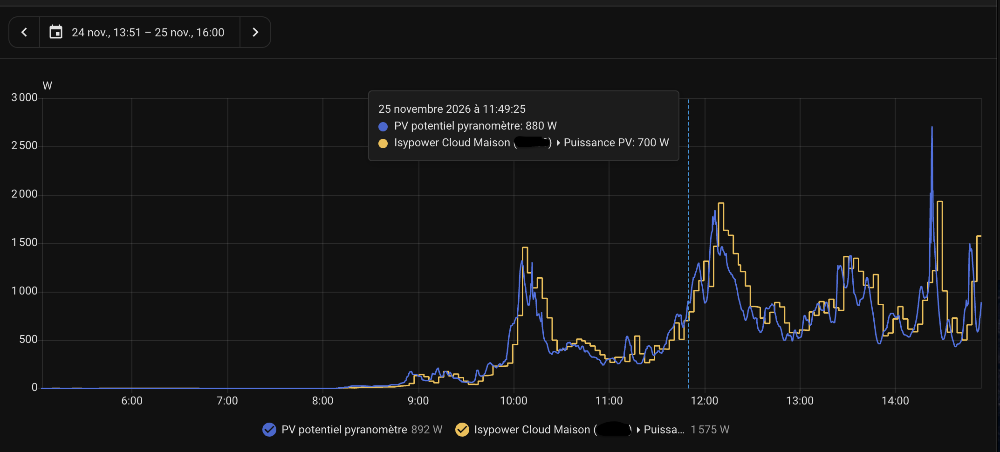

# Utilisation d'un pyranomètre pour piloter la borne VE Izypower avec Home Assistant

En mode zéro injection, les micro-onduleurs limitent leur production à ce que la maison consomme et à ce que la batterie peut absorber. Même en plein soleil, le compteur peut donc afficher **0 W injecté** alors que les panneaux pourraient produire assez pour recharger la voiture.

L'idée est de placer un **pyranomètre (PYR20)** avec la même orientation et la même inclinaison que les panneaux solaires afin de mesure l’ensoleillement qu’ils reçoivent. À partir de cette mesure, Home Assistant estime la puissance que les panneaux pourraient produire, puis soustrait la consommation de la maison hors borne et la puissance de charge de la batterie. Il obtient ainsi le **surplus solaire disponible** pour la voiture.

Si ce surplus estimé atteint 1 400 W, Home Assistant autorise l’injection sur le réseau via l’API Izypower. Le smart meter mesure alors la puissance réellement injectée. La borne peut s’appuyer sur cette mesure pour démarrer la recharge selon les règles de son mode Hybride ou Intelligent.


## Matériel & Prérequis

- un pyranomètre fonctionnant en RS485 - [fiche produit](https://fr.aliexpress.com/item/1005004781181473.html)
- Un ESP32 type M5Stack ATOM - [fiche produit](https://www.amazon.fr/M5Stack-Atom-ESP32-Cartes-d%C3%A9veloppement/dp/B0CTGKJPRW) 
- Un module de conversion RS485 pour M5Stack ATOM : "Tail485" - [fiche produit](https://fr.aliexpress.com/item/1005003297531645.html)
- Une alimentation 12v
- [Intégration Isypower Cloud (Materfrance) pour Home Assistant](https://github.com/StefanPlizga/izypower_cloud)
- 





## 1. Mesurer l’irradiance

Le PYR20 mesure l’irradiance dans le plan de sa face sensible, en watts par mètre carré. Placer la face sensible dans le même plan que les modules (orientation **et** inclinaison), à un emplacement représentatif de leur ensoleillement. Une ombre portée sur le seul capteur fausse l’estimation.

Raccorder l’alimentation du PYR20 et la paire de données A/B d’après le repérage de la notice de la variante reçue. Brancher le Tail485 sur le port Grove de l’ATOM. Vérifier séparément le mode d’alimentation de l’ATOM et le brochage du Tail485 avant toute mise sous tension. Une couleur de fil seule ne permet pas d’identifier sa fonction.

### Firmware ESPHome

Le profil ci-dessous reprend la configuration du projet. Vérifier l’adresse esclave, le débit et l’échelle du registre sur la notice du capteur. Définir les secrets Wi-Fi et API dans le fichier ESPHome local, valider le YAML, installer le firmware puis associer le nœud via l’intégration ESPHome de Home Assistant.

```yaml
esphome:
  name: pyranometre
  friendly_name: "Pyranomètre"
  min_version: 2026.9.0

esp32:
  variant: esp32
  flash_size: 4MB
  framework:
    type: esp-idf

logger:
  level: INFO

# Connexion chiffrée à Home Assistant.
api:
  encryption:
    key: !secret pyranometre_api_key

# Mises à jour Wi-Fi : réutilise la clé de l'API.
ota:
  - platform: esphome
    encryption:

wifi:
  ssid: !secret wifi_ssid
  password: !secret wifi_password
  power_save_mode: none

# Liaison entre l'ATOM Lite et le Tail485.
# Le Tail485 gère automatiquement le sens émission/réception.
uart:
  id: uart_pyr20
  tx_pin: GPIO26
  rx_pin: GPIO32
  baud_rate: 9600
  data_bits: 8
  parity: NONE
  stop_bits: 1

modbus:
  id: modbus_pyr20
  uart_id: uart_pyr20

# Paramètres d'usine du PYR20.
modbus_controller:
  - id: pyr20
    address: 0x01
    modbus_id: modbus_pyr20
    update_interval: 5s

sensor:
  - platform: modbus_controller
    modbus_controller_id: pyr20
    id: irradiance_solaire
    name: "Irradiance solaire"

    address: 0x0000
    register_type: holding
    value_type: U_WORD

    unit_of_measurement: "W/m²"
    device_class: irradiance
    state_class: measurement
    accuracy_decimals: 0

    # La valeur du registre est directement exprimée en W/m².
    # Si aucune nouvelle mesure n'arrive pendant 30 secondes,
    # la valeur devient inconnue.
    filters:
      - timeout: 30s

  - platform: wifi_signal
    name: "Signal Wi-Fi"
    update_interval: 60s
    entity_category: diagnostic

button:
  - platform: restart
    name: "Redémarrer"
    entity_category: diagnostic
```

Le PYR20 est interrogé toutes les 5 s. Le registre holding 0x0000 fournit ici un entier non signé en W/m². Après 30 s sans réponse, le filtre invalide la mesure. En cas d’absence de données, consulter le journal Modbus et vérifier l’alimentation, la paire A/B et les paramètres série. Contrôler dans HA que masquer brièvement le capteur fait baisser la mesure et que couper la communication la rend indisponible.

## 2. Estimer la puissance et le surplus

La puissance crête des panneaux est donnée pour une irradiance de 1 000 W/m² et une température de cellule de 25 °C. À température comparable, si l’irradiance est divisée par deux, la puissance potentielle est approximativement divisée par deux.

$$
P_{\mathrm{estimée}} = P_{\mathrm{crête}} \times \frac{G}{1\,000} \times k
$$

| Grandeur | Signification |
|---|---|
| $G$ | Irradiance mesurée par le PYR20, en W/m² |
| $P_{\mathrm{crête}}$ | Somme des puissances nominales des panneaux, en Wc |
| $k$ | Coefficient de calibration sans unité, initialement fixé à 1 |
| $P_{\mathrm{estimée}}$ | Puissance électrique potentielle avant plafonnement, en W |

Exemple de calcul avec 6 240 Wc : à 500 W/m² et avec $k=1$, le potentiel vaut $6\,240 \times 500 / 1\,000 = 3\,120$ W. Le package borne ensuite cette estimation entre zéro et la puissance AC maximale des micro-onduleurs, puis la lisse sur 30 secondes. Un coefficient unique corrige un écart moyen ; la température et les ombres locales peuvent encore faire varier la production.

**Surplus disponible pour la borne = potentiel AC lissé − consommation de la maison hors borne − puissance absorbée par la batterie en charge.**

Dans cet exemple de configuration, remplacer les puissances de démonstration (5 000 Wc et 4 500 W AC) et les identifiants génériques. Fusionner les entrées avec les sections YAML existantes. Si un capteur est déjà enregistré, conserver son unique_id et vérifier son entity_id dans les outils de développement.

La configuration complète est dans [packages/borne_solaire.yaml](packages/borne_solaire.yaml). Le même fichier contient le calcul, les assistants et l’automatisation. Installer une seule copie des capteurs.



### Installation du package et de la carte

1. Copier le package dans `/config/packages/borne_solaire.yaml`. Dans `configuration.yaml`, fusionner l’inclusion suivante avec la clé `homeassistant` existante. Si les packages sont déjà inclus, utiliser le dossier configuré.

   ```yaml
   homeassistant:
     packages: !include_dir_named packages
   ```

2. Dans le package **et dans la carte**, remplacer les alias ci-dessous par les entités de l’installation. Régler aussi les Wc, le plafond AC et le coefficient dans le premier capteur. Garder les commandes d’injection sur leur état fermé pendant la préparation.

Les exemples reprennent les noms des entités de l’installation de référence en retirant uniquement l’identifiant privé situé après `maison_`. Pour les adapter, copier l’`entity_id` complet depuis Home Assistant dans le package et la carte. Vérifier le préfixe réel de chaque entité : la puissance de la borne utilise ici `isypower_cloud`, les mesures de la maison utilisent `izypower_cloud`. Pour la calibration, rechercher également `sensor.izypower_cloud_maison_puissance_pv`.

| Alias à remplacer | Valeur attendue |
|---|---|
| `sensor.toiture_pyranometre_irradiance_solaire` | Mesure locale, W/m² |
| `sensor.izypower_cloud_maison_consommation`, `sensor.izypower_cloud_maison_puissance_batterie` | Puissances en W selon les conventions ci-dessous |
| `sensor.izypower_cloud_maison_derniere_mise_a_jour` | Horodatage ISO de la dernière acquisition réussie avec fuseau |
| `binary_sensor.heures_creuses` | Actif pendant toutes les plages HC |
| `binary_sensor.vehicule_branche` | Actif si le câble est branché. En l’absence de source fiable, retirer explicitement cette condition et sa ligne sur la carte pour autoriser le solaire même sans véhicule. |
| `switch.blocage_d_injection`, `number.limite_d_injection` | Contrôle actif = plafond appliqué, limite en W avec retour d’état vérifié |
| `sensor.isypower_cloud_maison_puissance_borne_de_recharge` | Puissance de charge mesurée, pour l’affichage |

3. Vérifier la configuration HA, redémarrer, puis vérifier les identifiants créés. Dans le tableau de bord, choisir **Modifier → Ajouter une carte → Manuel** et coller [lovelace/borne_solaire.yaml](lovelace/borne_solaire.yaml). La carte utilise les composants natifs.
4. Laisser **Pilotage solaire** désactivé pour observer le surplus et les conditions. Régler **Limite d’ouverture** à la valeur validée pour le site (0 à la première installation). Activer ensuite le pilotage. Si les commandes ne sont pas déjà en position fermée, le contrôleur commence par les réconcilier. Désactiver le pilotage pendant une session demande le retour au zéro injection. Une fois la fermeture confirmée, la borne continue de suivre sa programmation native.


| Entrée locale | Vérification à faire dans l’historique |
|---|---|
| Consommation maison hors borne | Dans le montage de référence, la mesure cloud exclut déjà la borne. Si le compteur local l’inclut, retirer la puissance réelle de la borne une seule fois. Exclure aussi une éventuelle charge batterie déjà comptée. |
| Puissance batterie | Normaliser en W avec la charge positive. Soustraire la charge effective, même à SOC partiel. Une décharge ne crée aucun surplus solaire. |
| Production PV AC réelle | Sert de référence de calibration. Une production bridée sous-estime ce que les panneaux pourraient fournir. |
| Puissances réseau et borne | Vérifier le sens import/export et observer si la borne absorbe effectivement le surplus après ouverture. |
| Véhicule branché | Utiliser un état de câble fiable lorsqu’il est disponible. Une borne activée ou une puissance de charge nulle ne suffit pas à déduire cet état. |
| Dernier relevé cloud | Utiliser l’horodatage d’acquisition ou de synchronisation réussie. Une puissance stable peut être fraîche, même si sa valeur n’a pas changé. |

Exemple : avec 3 600 W de potentiel lissé, 900 W pour la maison et 1 200 W de charge batterie, il reste **1 500 W** pour la borne. Si elle commence à charger, sa propre consommation doit rester exclue du calcul.

## 3. Calibrer sur des mesures exploitables

1. Enregistrer l’irradiance brute et la production PV AC réelle sur plusieurs journées. Dans HA, vérifier que Recorder conserve les deux séries sur la durée de l’essai. Une rétention de 30 jours est possible via `recorder.purge_keep_days`.
2. Choisir des périodes de soleil stable où la production est entièrement absorbée ou l’export autorisé, sous le plafond AC et avec un rayonnement suffisant. Écarter les passages nuageux rapides, le lever du jour, les ombres locales et les plateaux d’écrêtage. Sous zéro injection avec batterie pleine et maison peu consommatrice, l’écart observé mesure surtout le bridage.
3. Conserver les lectures locales à 5 s pour le pilotage. Pour la comparaison, ramener les deux séries aux mêmes instants. Si la valeur cloud est une moyenne, moyenner l’irradiance sur sa fenêtre réelle. Si c’est un instantané, prendre la mesure locale la plus proche de l’acquisition. Vérifier le décalage entre acquisition et publication.
4. Pour chaque paire retenue, calculer **k = PV AC réel / (puissance crête × G / 1 000)** avant plafonnement. Par exemple, 2 700 W mesurés pour 5 000 Wc à 600 W/m² donnent *k* = 0,90. Prendre la médiane des ratios et valider sur une autre journée, particulièrement autour du seuil de démarrage. Si l’erreur dépend fortement de l’heure, examiner l’ombre et l’alignement temporel avant de modifier *k*.

## 4. Ouvrir et refermer la fenêtre solaire

L’« ouverture » autorise l’injection. La « fermeture » rétablit le zéro injection. Home Assistant agit sur le contrôle d’injection du système PV. Le mode Hybride, les horaires enregistrés et la commande Marche/Arrêt de la borne restent sous la responsabilité de son programme natif.

| État ou événement | Décision Home Assistant |
|---|---|
| Fermé, de jour, hors heures creuses | Avec véhicule branché si cette information est disponible, démarrer un compteur dès que le surplus atteint **1 400 W**. Exiger **5 min continues** et au moins un nouveau relevé cloud valide depuis le début du compteur avant d’ouvrir. Repartir de zéro si une condition tombe. |
| Ouvert, surplus inférieur à 1 400 W | Fermer après **1 min continue** de déficit. Si le surplus revient à 1 400 W pendant cette minute, annuler le compteur de déficit. |
| Fermeture confirmée | Interdire toute nouvelle ouverture solaire pendant **10 min**, puis exiger à nouveau les 5 min de surplus. |
| Coucher du soleil, début d’heures creuses ou débranchement détecté | Refermer immédiatement une fenêtre solaire ouverte. Pendant toute la plage HC, y compris en journée, laisser la borne suivre sa programmation. La fermeture ne doit envoyer aucune commande d’arrêt à la borne. |
| Mesure requise invalide, ou dernier relevé cloud datant de plus de 10 min | Bloquer l’ouverture, annuler la qualification en cours et demander la fermeture si la fenêtre est ouverte. Reprendre sur des données fraîches. |

### Traduction en automatisations HA

Le package regroupe l’ouverture et la fermeture dans une automatisation sérialisée. Il réévalue les décisions sur changement des conditions, au démarrage de HA et toutes les 5 s. Les capteurs template qui utilisent l’heure courante sont aussi recalculés par HA à la minute ; l’expiration de la fraîcheur cloud ou la fin de pause peuvent donc être constatées jusqu’à une minute après leur échéance.

- **Ouverture** : activer le contrôle du blocage d’injection, attendre sa confirmation, écrire la limite d’ouverture autorisée et attendre sa relecture, puis désactiver le contrôle et vérifier le retour d’état. La valeur discutée pour le matériel de référence était **6 400 W**. Ce réglage d’ouverture est distinct du seuil de démarrage et du plafond AC du modèle. Vérifier la valeur admise et l’autorisation d’export propres au site avant d’activer le script.
- **Fermeture** : activer le contrôle, confirmer son activation, régler la limite à **0 W**, confirmer le zéro et laisser le contrôle actif. Employer les actions `switch.turn_on/off` et `number.set_value` seulement après avoir identifié les commandes locales correspondantes.
- **Confirmation** : prévoir une attente bornée adaptée à la cadence de l’intégration. En cas d’échec, interrompre l’ouverture, demander le retour au zéro injection, signaler l’état non confirmé et réessayer la fermeture quand la communication revient. Revérifier les conditions juste avant de libérer le contrôle. Sérialiser les écritures pour éviter qu’une ouverture retardée annule une fermeture.
- **Reprise** : mémoriser l’échéance de pause dans un assistant date/heure persistant. Après redémarrage, réconcilier le contrôle et la limite avec leurs états réels, repartir fermé, respecter la pause restante et recommencer la qualification. Un état HC ou solaire inconnu interdit l’ouverture.

### Essai avant activation

Observer d’abord les décisions dans les traces HA avec les écritures désactivées. Tester un passage à 1 400 W de 4 min 59 s, puis de 5 min avec un nouveau relevé cloud. En fenêtre ouverte, comparer un creux de 59 s à un creux d’une minute. Vérifier ensuite la pause, le coucher du soleil, la perte du cloud et le passage en HC en pleine charge. Lors d’un essai réel, comparer la limite relue, la puissance au compteur réseau et celle de la borne. Vérifier enfin qu’une recharge HC démarre et se poursuit avec le zéro injection actif.

Les noms d’entités et les valeurs d’installation de cet exemple sont à adapter. Les scripts d’écriture dépendent de l’intégration locale. Voir [AGENTS.md](AGENTS.md) pour préparer cette adaptation.

Documentation : [capteurs template Home Assistant](https://www.home-assistant.io/integrations/template/) · [filtre temporel](https://www.home-assistant.io/integrations/filter/) · [contrôleur Modbus ESPHome](https://esphome.io/components/modbus_controller/).
